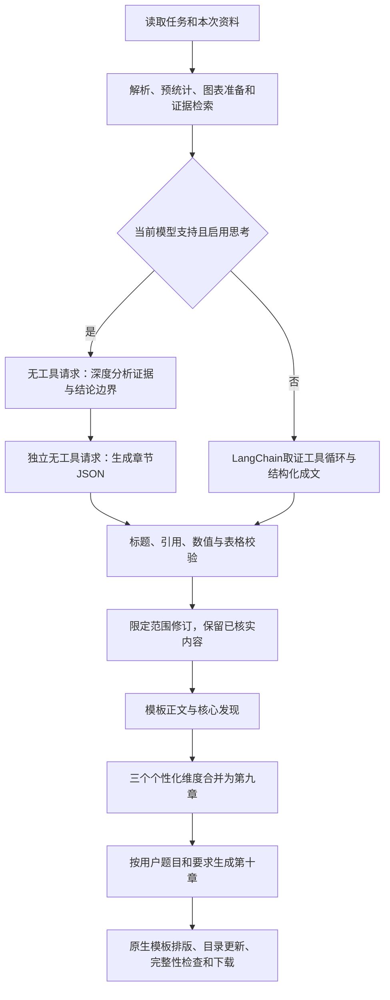

# 完整报告扩展与思考模式

本次更新将原独立诊断合并到正式报告，并增加用户专题。报告模板版本为2.1。用户现有上传资料、模型密钥与历史报告保留；旧记录原有的独立诊断文件仍可下载。

## 使用方法

1. 选择本次资料与模板章节，默认全选。
2. “第九章 个性化报告”自动追加，包含专业结构与培养定位、毕业学习成果、课程与实践教学体系。逐项回答原来的三个核心问题，综合校本证据给出判断、行动、条件与评价方法。
3. 如需专题，勾选“添加主题章节”，填写题目和分析要求。第十章标题采用用户题目，要求随任务保存及重试。未填写专题时不输出该章。
4. 模型设置中的“章节深度分析”默认自动适配，可显式启用或关闭额外分析；选择思考强度，Qwen与旧版Claude还可使用思考预算。
5. 新任务完成后下载一份完整Word，顺序为模板内容 → 个性化报告 → 用户专题 → 必要的未开展项目简表。正文和文末不展示资料来源，完整来源与校验记录保存在系统内部。

## 章节生成流程

程序预先执行题项统计、图表绑定及检索；思考请求不携带工具或历史助手消息，避免思考字段、工具协议或Gemini签名丢失。只把模型最终输出的分析建议用于成文，不保存、展示或导出内部思维链。每次分析和成文都计入调用/时间预算并检查终止状态。

JSON由Pydantic校验。格式错误最多修订两次；内容错误最多进行两次局部修订，修订保留原引用、原主题及段落/表格数量，不覆盖已通过内容。仍缺少依据的内容跳过并写明边界；认证、余额、网络、超时等继续作为执行错误。未来规划可以提出建议和评价标准，不能将假设、预测数字或改革方案写成已发生的事实。

## 供应商适配

名称、接口地址和密钥均来自网页配置。下表描述目前适配方式，第三方转发接口是否接受同样参数须以其接口文档和连接测试为准。

| 系列 | 分析阶段 | 结构化成文阶段 | 自动识别范围 |
| --- | --- | --- | --- |
| DeepSeek | `thinking.type=enabled`；低强度映射low，中/高映射high | 通常disabled/none；reasoner按思考模型使用独立无工具请求 | deepseek前缀 |
| Qwen | 混合模型`enable_thinking=true`，使用流式与`thinking_budget` | 混合模型关闭；仅思考模型仍流式并降低预算 | Qwen3、QwQ和新版qwen-plus/flash/turbo；instruct排除，早期快照排除 |
| GLM | `thinking.type=enabled`；5.2及以上设置适用的effort | 可切换型号关闭；5.3等强制思考型号用low且无工具 | GLM4.5及以上 |
| GPT | Responses API的`reasoning.effort` | 使用low保留兼容性 | o1/o3/o4、GPT5及以上 |
| Claude | 新Opus/Sonnet用adaptive和effort；旧型号用enabled及budget_tokens | adaptive使用low，旧型号disabled | Claude3.7及4系列以上，Fable/Mythos |
| Gemini | OpenAI兼容接口`reasoning_effort` | 使用low，独立无工具请求 | Gemini2.5及3系列以上 |

“关闭额外深度分析”表示跳过单独的分析请求。部分模型只支持思考，成文时仍会使用其允许的最低/较低参数。未知名称默认保留普通路径，可显式启用后测试；显式启用并不能使不支持思考的型号获得该能力。思考与正文上限分别配置，默认16000和12000 tokens；任务默认最多120次调用、3600秒。本机旧版默认的80次调用和1800秒已升级为上述预算，其他运行参数保留。

思考通常增加耗时与token消耗，有助于组织跨章节证据和规划关系，但不会增加缺失资料，也不能保证结论正确。最终仍以实际来源和数值校验为准。

## 人工模板复用

- `config/report-template.docx`保留原生封面、必要页眉页脚、样式和编号定义，原报告正文、作者页和既有结论已移除。
- `config/template-profile.json`保存原段落直接格式、标题编号、页面参数及表格单元格样式。学校和届次按当前任务替换。
- 原生页眉背景图片保存在`config/template-assets`并重建文档引用；偶数页页眉、左右页码、小节编号的逐章重置和图下标题沿用原规则。正文采用常规字重，发现段落首句加粗；供应商Logo与署名移除。
- `config/report.json`保留固定章节和二三级主题，并恢复109个有效指标标题；原报告两个空白标题占位不输出。`config/visuals.json`的154项图表对应原指标位置。
- 提示词逐项要求指标现状、样本口径、差异解释和培养质量含义；复杂章节最多96个内容块，避免少量泛化段落代替完整分析。
- 程序记录`template-coverage.json`，未形成文字分析的模板项目明确说明。能核实的图表保留，不将缺失指标补零或搬用参考报告数字。
- 本机有Word时，隐藏实例更新目录和页码后保存；未安装Word或更新失败时保留可更新字段，输出元数据`layout.status=manualUpdateRequired`。实际页数随资料及选择章节变化。

模板一致性是标题、分析项目和排版规则一致。实际统计结论、图表数量及文字长度由本次证据决定，不复制样例的事实和页数。

## 代码和运行记录

六个业务Skill继续分别负责取证、统计、模板写作、个性化/专题分析、图表及审校。新增`analysis.md`和`compose.md`，与系统、章节、修订提示词配合。`reasoning.py`集中管理供应商参数，`models.py`实现两阶段LangChain调用，`provider_models.py`保留安全的思考用量标记。工作流仍由LangGraph编排。

每次执行保存扩展章节草稿、模板覆盖、内容缺口和模型调用记录。调用记录只保存阶段、耗时、用量及是否观测到思考，不记录思考文本或密钥。模型配置数据库自动迁移新思考字段，原密钥密文和revision保留。

## 本次验证

智能体自动化测试148项通过、1项可选在线测试跳过；最终模板及扩展专项29项通过。Spring Boot的10项测试及前端构建通过。用合成资料实际调用DeepSeek，验证了原模板章节、个性化维度、用户主题和限定范围修订；前端经Spring Boot的连接测试确认`reasoningObserved=true`。完整流程及原生Word排版另用合成内容检查，两个新增章节、目录、长表和页码均已核对。

其他供应商已通过参数及SDK请求结构测试，尚未使用对应真实密钥在线生成。真实学校整份报告的内容质量仍需在用户下一次生成后结合实际资料检查，本次未覆盖已有历史文件。

## 官方接口依据

- [DeepSeek思考模式](https://api-docs.deepseek.com/zh-cn/guides/thinking_mode/)与[Chat Completions参数](https://api-docs.deepseek.com/zh-cn/api/create-chat-completion/)
- [Qwen深度思考](https://help.aliyun.com/en/model-studio/deep-thinking)
- [GLM思考模式](https://docs.z.ai/guides/capabilities/thinking-mode)与[参数说明](https://docs.z.ai/guides/overview/concept-param)
- [OpenAI推理模型](https://developers.openai.com/api/docs/guides/reasoning)
- [Claude思考模式](https://platform.claude.com/docs/en/build-with-claude/thinking)与[旧版扩展思考](https://platform.claude.com/docs/en/build-with-claude/extended-thinking)
- [Gemini兼容接口](https://ai.google.dev/gemini-api/docs/openai)
