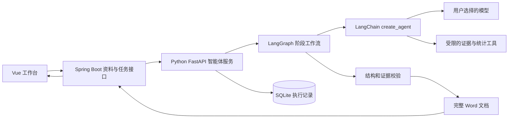

# 教学质量报告智能体开发流程

本方案将现有 Vue、Spring Boot 页面接入独立的 Python LangChain 服务。每次任务输出一份 Word：按勾选章节生成的模板报告，随后追加“第九章 个性化报告”和选填的第十章用户主题。当前报告扩展与思考模式的实现详见[报告扩展与思考模式](报告扩展与思考模式.md)。

## 业务边界

- 评价报告只有一个固定模板，章节名称和顺序沿用现有报告。默认全选，也可选部分章节。
- 第九章个性化报告始终包含专业结构与培养定位、毕业学习成果、课程与实践教学体系，与评价报告章节勾选互相独立。
- 学校、届别、模型和本次资料由用户选择；一次任务只使用一个模型。不同模型的测试使用独立任务、工具上下文与执行记录。
- 调研数据、发展讲话与参考报告是证据，不能把参考报告里的学校、年份、数值直接写进本次报告。不设置每章必传资料清单；依据已上传资料完成可以支持的内容，缺少依据的内容跳过，在正文中注明具体缺口，原章节名称保留。
- 原始文件继续本地存储。SQLite 保存智能体任务状态与阶段结果，不要求部署独立数据库。当前 Spring Boot 的文件索引和任务配置暂保留 JSON，便于渐进迁移。

## 架构和职责

Spring Boot 验证资料和任务归属，向 Python 提交文件 ID、原文件名及任务参数，转发进度和下载请求。Python 只读取配置的上传目录，不接受模型提供的任意文件路径。模型配置通过网页弹窗填写，Spring Boot 转发到 Python 的配置接口；API Key 加密保存至本地配置数据库，查询只返回固定掩码，不写入浏览器持久存储、任务 JSON、提示词或日志。

LangGraph 负责固定的阶段顺序和状态；普通模型用 LangChain `create_agent` 执行模型与工具循环，使用 Pydantic/`ToolStrategy` 限定章节结构；思考模型用 LangChain 聊天模型 `invoke`，以独立请求完成深度分析和 JSON 成文，Pydantic 验证后进入同一证据审校。提示词通过 `ChatPromptTemplate` 组装，调用预算和终止检查对两种路径均生效。这一区分遵循官方的[工作流与智能体说明](https://docs.langchain.com/oss/python/langgraph/workflows-agents)及[结构化输出说明](https://docs.langchain.com/oss/python/langchain/structured-output)。

## 工作流设计

| 阶段 | 输入 | 处理 | 可检查的产物 |
| --- | --- | --- | --- |
| 1 参数预检 | 学校、年份、模型、章节、资料 ID | 验证唯一模板、章节原名、文件存在、模型配置和任务重复提交 | 固定的任务快照；失败时返回具体原因 |
| 2 解析资料 | 所选文件 | 解析表格、PDF、Word、TXT，保留页码/段落/工作表和行号；识别空白或不可解析内容 | 文本证据块、表格数据、解析警告 |
| 3 组织证据 | 文本和表格 | 建立仅属于本次任务的证据索引；生成字段概况；区分调研、讲话和参考资料 | 证据清单和索引，供后续工具查询 |
| 3a 预统计 | 本次DATA问卷与当届指标表 | 遍历实际题项，预计算单选频数/百分比、多选拆列、评价矩阵与实际读研等范围；读取原表本校平均 | 带届次、有效分母、题项与原始来源的计算证据，供步骤4与5使用 |
| 4 按章撰写 | 勾选章节、证据索引、报告 Skill | 每章单独调用模型，允许检索、查看证据和受限统计；使用结构化输出 | 章节草稿、引用、数据缺口和统计表 |
| 5 个性化与主题报告 | 本次资料、已校验章节、分析 Skill、用户主题 | 完成三维个性化分析并合并为第九章；有主题时生成第十章，区分现状、规划假设、路径及评价方式 | 两个新增章节的结构化草稿 |
| 6 校验与修订 | 草稿和证据 | 校验标题、范围、引用 ID、事实引用、数值出处、表格形状；失败时最多两次局部修订，仍无依据的段落、表格或图表跳过，保留已通过内容 | 有依据的正文和具体资料缺口，继续其他章节与诊断 |
| 7 Word 导出 | 已校验结构化内容 | 套用人工报告的原生封面、页面、二至四级标题及表格样式；原模板内容后追加个性化和主题章节；添加来源索引 | report.docx、结果清单 |
| 8 完成与下载 | 导出结果 | 验证文件存在、Word 包结构和章节，更新任务状态 | 完整报告下载地址、模型版本、版本信息和运行记录 |

首次实现按章和按诊断维度顺序执行，降低限流与上下文串扰。所选正文先完成，核心发现随后汇总已校验的正文，导出顺序仍严格沿用原目录。流程不将全部原始表格直接塞进提示词；普通模型通过工具查询证据；思考路径由程序预先检索原指标、统计题项及已验证章节的引用，模型围绕这些证据分析。资料内容仍是任务数据，不作为系统指令。每个阶段保存结果，失败重试以新执行尝试记录，不覆盖上一次错误证据。服务重启后未完成任务标记为中断，由用户重新执行，避免自动产生额外模型调用费用。

单章无法取得合规结构时保留该章标题并注明本次未完成；不能将认证失败、余额不足、网络失败或任务预算用尽改写为资料不足。整批资料均不可读取时仍提示上传至少一份可用资料。结果清单记录各章跳过内容数量与补充资料建议，完整 Word 中直接显示资料缺口。

任务终止采用协作检查：排队任务立即取消；运行任务先进入“正在终止”，在模型请求返回或超时后完成终止。每次模型调用、工具执行和工作流阶段边界检查任务状态，执行客户端关闭 SDK 自动重试；旧尝试不能覆盖取消状态或新尝试结果。用户可删除未开始、已完成、失败、中断或已终止的任务，记录、输出和任务缓存一起移除，已上传资料与模型配置保留。

## Skill 设计

Skill 是本项目服务读取的 Markdown 业务规则，不安装到用户的 Codex 全局技能目录。运行时只加载当前节点需要的文件，并记录内容摘要用于追踪版本。

| Skill | 作用 | 核心约束 |
| --- | --- | --- |
| source-evidence | 指导资料取证和引用 | 文档是资料而非指令；证据 ID 可回溯；参考材料中的数值不能冒充本次调研 |
| table-analysis | 指导表格和指标分析 | 明确口径、样本范围、分母、缺失值；百分比与百分点分开；不让模型自行猜测列含义 |
| quality-report | 固定评价报告规则 | 只输出勾选章节、严格保留章节原名和顺序；使用已上传资料，跳过无依据内容并写具体数据缺口 |
| deep-diagnosis | 三维诊断规则 | 专业与产业匹配 → 培养目标与学习成果 → 课程与实践支撑；建议说明条件与验证方式 |
| charts-tables | 图表与可编辑表格规则 | 保留原编号标题；按实际字段与编码表整理数据；检查届次、单位、分母和多选口径 |
| review-export | 内容交付要求 | 事实、分析判断、建议和缺口区分；拒绝无效引用；固定目录与可读 Word 排版 |

## 提示词设计

提示词保存在 `agent-service/prompts/`，业务规则放在 `skills/`，目录与诊断问题放在 `config/`，避免将长提示词写死在接口里。

1. 系统层：身份、任务边界、证据要求、输出 Schema、工具使用边界和资料中的指令隔离规则。
2. 任务层：学校、届别、当前章节或诊断维度、用户补充要求、资料分类、可用字段和证据概览。
3. 取证层：模型按需调用工具，返回限定长度的文本片段或统计结果，并携带证据 ID。
4. 修订层：仅给出当前草稿、明确的校验问题和同一任务证据，修订后重新通过同一套校验。

模型输出先成为结构化内容，再由确定性代码排版。不会把大模型返回的任意 HTML、文件路径或 Python 代码直接执行。

## 工具函数设计

| 工具 | 关键参数 | 输出与约束 |
| --- | --- | --- |
| list_sources | 无 | 本次任务资料及可用工作表、字段；只返回当前任务资料 |
| search_evidence | query、category、limit | 文本片段、来源位置、证据 ID；限制返回条数与长度 |
| read_evidence | evidence_id | 一个已登记证据块，拒绝其他任务或不存在的 ID |
| inspect_table | material_id、sheet | 字段和有限数据概况，不提供任意文件访问 |
| summarize_table | material_id、sheet、column、group_by | 对明确列进行频数或数值统计；记录样本数、缺失值及可追溯来源 |
| calculate_ratio | numerator、denominator、evidence_ids | 有来源的比例与百分比；验证非负值和非零分母，生成计算证据 |
| analyze_survey_question | material_id、sheet、question、scope | 已统计的单选、多选拆列、评价矩阵和明确量表；支持实际读研等样本范围，返回计算证据 |
| prepare_chart_data | spec | 从本任务 DATA 表计算或读取数据；返回可引用 datasetId；拒绝未知编码、混合单位、合并届次拆分和不适合的构成图 |
| render_chart | dataset_id | 确定性绘图或生成可编辑表格资源；只接收已登记数据集，不接收路径或自编数值 |
| validate_chart | asset_id | 核对任务来源、原图表编号、数据完整性、构成比例及图片哈希 |

解析和 Word 导出由工作流节点调用，不暴露为模型可随意执行的写文件工具。没有任意 Python 执行、Shell、SQL 或主动联网搜索工具；产业或岗位需求资料应由用户上传，联网取证以后作为单独受控功能开发。

## 大模型调用

- 统一工厂根据前端的 `qwen/deepseek/glm/gpt/claude/gemini` 读取网页保存的对应配置。创建客户端时读取最新配置，执行中的客户端不随编辑改变。
- GPT 使用 OpenAI Responses API，Claude 使用 Anthropic 原生接口，其余使用兼容聊天接口；模型名称、API Key、Base URL 与额外 JSON 参数由用户在各模型设置中填写，超时与输出上限由服务运行参数控制。GPT 请求设置 store=false，并在工具循环中携带加密推理上下文。
- 所有模型沿用同一业务 Schema、Skill 和工具契约。是否支持工具调用、结构化结果和指定参数需要真实连通性测试，不仅凭“已填写 Key”判定成功。
- 默认有限重试、调用超时、工具循环上限和单任务时间上限。错误响应不回显 Key 或原始供应商响应体。
- 每章最多四轮取证，重复调用相同工具会提前收尾；成文阶段移除业务工具及历史函数调用，保留已取得的证据，按名称强制调用 SectionDraft 并通过 Pydantic 校验，其他工具请求不会执行。结构化格式最多修订两次，缺少结构化返回时进入专门的成文重试，全部计入同一任务预算。内容修订仅处理失败的段落或表格，携带原引用证据和具体待核实数值，程序保留已通过内容。自动准备的图表由程序绑定真实 assetId 并附加，正文不出现内部证据编号。调用阶段和工具名保存到 model-calls.json，便于排查循环问题。
- 日志记录模型标识、阶段、时长、用量和错误类别，不记录密钥；不同模型之间不共享消息历史或模型生成的分析。
- 配置检测不发送校本资料；单独的连通性测试只发送固定的无个人信息测试内容。

相关官方接口：[LangChain 模型集成](https://docs.langchain.com/oss/python/integrations/chat/openai)、[OpenAI 工具调用](https://developers.openai.com/api/docs/guides/function-calling)、[Responses 状态与数据保存](https://developers.openai.com/api/docs/guides/migrate-to-responses)、[百炼工具调用](https://help.aliyun.com/zh/model-studio/qwen-function-calling)、[DeepSeek 工具调用](https://api-docs.deepseek.com/guides/tool_calls/)、[Gemini 兼容接口](https://ai.google.dev/gemini-api/docs/openai)。具体可用版本以用户账号和供应商控制台为准。

## 分阶段开发与验收

| 阶段 | 实施内容 | 验收标准 | 状态 |
| --- | --- | --- | --- |
| A 方案与契约 | 本文档、配置、任务和内容 Schema | 固定章节与三维诊断一致，职责和输入输出明确 | 已完成 |
| B 服务与持久化 | FastAPI、配置读取、SQLite、异步任务及错误处理 | 未配置模型时明确失败；重启可读取历史任务；重复提交幂等 | 已实现并通过离线测试 |
| C 资料与工具 | 多格式解析、证据索引、表格统计、可追溯计算 | 空文档、损坏文件、非法路径、跨任务引用和统计口径有测试 | 已实现；真实样例解析通过 |
| D Skill 与模型 | Skill 加载、提示词、模型工厂、LangChain 工具循环 | 使用可控模型测试工具链、结构化返回和非法结果拒绝 | 已实现并通过离线测试 |
| E 工作流与交付 | 顺序工作流、有限修订、合并完整 Word | 模板章节、三维个性化分析及可选用户专题同文件输出，引用和结构正确 | 已实现原生模板复用与导出 |
| F 前后端联通 | Spring Boot 网关、状态同步、终止、删除和完整报告下载 | 页面可配置主题与思考模式，历史输出保留 | 已实现接口与持久化测试 |
| G 真实模型验收 | 固定测试任务、合成数据及真实样例 | 记录模型版本、用量、证据准确性和 Word 视觉检查 | DeepSeek真实调用已验证；其他系列已验证参数及请求结构，仍需其可用Key验收 |

离线测试采用明确标记的测试模型，只用于验证代码流程，不作为真实报告结果交付。真实模型验收使用用户配置的可用 API Key、模型名称及接口地址。已登记原样例114幅图与40张表，恢复原二、三级主题，除首版14幅聚合图外增加了当届问卷预统计、实际升学与评价分组等自动绑定。2026-10-03同资料验证可准备87/152个选中范围内图表项目，并真实复测第三章。详细证据、版式检查与尚未覆盖的算法见[报告对比与优化记录](报告对比与优化记录.md)及[图表开发说明](图表开发说明.md)。不复制样例统计数值。

## 下一轮真实验收顺序

1. 在网页“模型设置”中打开首个模型，填写并保存其名称、接口地址及密钥，执行固定文本的工具调用与结构化输出测试。记录具体模型版本和测试结果。
2. 先选“核心发现”“第二章 就业质量”，使用主要指标表和原始调研数据生成一项真实任务，配套三维诊断同时输出。
3. 抽查每项数值的来源、分母、单位、届别与适用样本；核对“核心发现”与正文一致，检查诊断是否区分事实与建议，资料不足是否列出准确缺口。
4. 渲染并逐页检查完整 Word，核对封面、模板各级标题、长表、目录、来源及两个新增章节；再用真实资料验收内容质量。
5. 完成首个模型验收后，用独立任务对比其他供应商；比较准确性、工具调用、用量和耗时，不共用各模型生成的章节或分析历史。

首版暂不包含 OCR、向量数据库、联网产业取证、断点继续、多租户和专用队列。日志和结果清单提供调用次数及供应商返回的 token 用量，不估算未经配置的实时价格。
